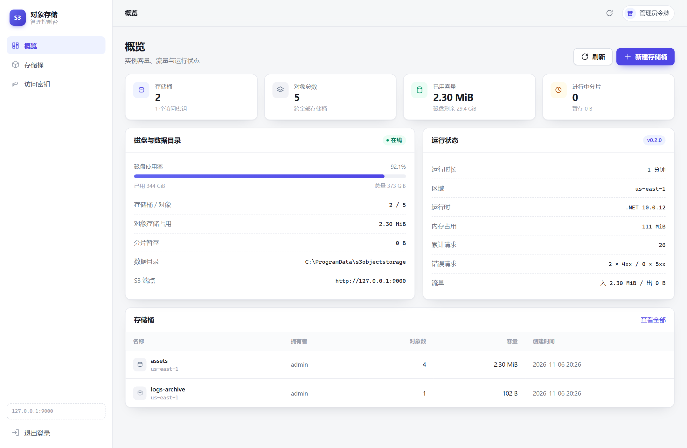

# S3ObjectStorage

**An S3-compatible object storage server built from scratch on .NET 10**, with a built-in web
admin console and a single-container deployment path.

[](https://github.com/OPEN96/ObjectStorage/actions/workflows/ci.yml)
[](LICENSE)
[](https://dotnet.microsoft.com/)

[中文文档](README.md) · [API support](docs/api-support.md) · [Configuration](docs/configuration.md) ·
[Deployment](docs/deployment.md) · [Client guide](docs/client-guide.md)

It implements the core AWS S3 REST API and SigV4 (Authorization header, presigned URLs,
`aws-chunked` streaming payloads, and MinIO's `STREAMING-UNSIGNED-PAYLOAD-TRAILER` variant).
It has been verified against the AWS SDK for .NET, the MinIO .NET SDK, `minio-py`, and the `mc` CLI.

> **Good for**: single-node object storage, internal file services, S3 protocol learning, and S3
> test doubles in CI.
> **Not for**: multi-node replication, versioning, object lock, or fine-grained IAM.



## Features

- Bucket & object CRUD, ListObjects V1/V2 (`prefix`, `delimiter`, pagination, `encoding-type=url`,
  `fetch-owner`), Range GET, conditional requests, bulk delete, CopyObject, user metadata.
- Multipart upload: initiate / upload part / complete / abort / list parts / list uploads.
- SigV4 with presigned URLs and three `aws-chunked` variants (signed chain, trailer, unsigned+trailer).
- MinIO-compatible behavior: health endpoints, `encoding-type=url`, transport header stripping.
- Admin console at `/admin` (vanilla HTML/CSS/JS, no build step).
- Crash-safe writes: temp file → atomic rename, hashing while streaming.
- Operational features: request IDs, `live`/`ready` health checks, non-root container,
  startup configuration validation.
- 85 xUnit tests including end-to-end tests against a real Kestrel server with AWS and MinIO SDKs.

## Quick start

Requires the [.NET SDK 10.0.100+](https://dotnet.microsoft.com/download).

```bash
git clone git@github.com:OPEN96/ObjectStorage.git && cd ObjectStorage
dotnet run --project src/S3ObjectStorage.Api
```

`dotnet run` loads the `Development` profile:

| Item | Development default |
| --- | --- |
| S3 endpoint | `http://127.0.0.1:9000` |
| Access key / secret | `AKIAEXAMPLELOCAL001` / `local-development-secret-please-change-me` |
| Admin console | <http://127.0.0.1:9000/admin/>, token `dev-admin-token-change-me` |

These values exist **only** in `appsettings.Development.json`. In `Production` the server refuses
to start without an explicit admin token and bootstrap access key.

```bash
aws --endpoint-url http://127.0.0.1:9000 s3 mb s3://demo
aws --endpoint-url http://127.0.0.1:9000 s3 cp README.md s3://demo/README.md
aws --endpoint-url http://127.0.0.1:9000 s3 ls s3://demo/
```

### Docker

```bash
cp .env.example .env
# Replace ADMIN_TOKEN, S3_ACCESS_KEY and S3_SECRET_KEY
docker compose up -d --build
```

## Testing

```bash
dotnet test                                # 85 unit + integration tests

python scripts/smoke.py                    # independent SigV4, 18 checks
python scripts/minio_compat.py             # minio-py, 20 checks
bash scripts/mc_compat.sh                  # mc CLI, 12 checks
```

The Python/mc scripts require a running server; see the Chinese README for details.

## Build & release

One command restores dependencies, builds, tests, and publishes artifacts:

```bash
bash scripts/build.sh                 # restore + build + test + publish
bash scripts/build.sh --no-test       # skip tests for a fast package
bash scripts/build.sh --build-only    # build only
bash scripts/build.sh --clean         # clean bin/obj/artifacts first

# Self-contained single-file cross-compile (no .NET runtime on the target machine)
RID=linux-x64 bash scripts/build.sh
```

Artifacts land in `artifacts/publish/`. Supported environment variables (`CONFIG`, `VERSION`,
`RID`) are documented in the script header.

## Security

- SigV4 required by default; payload SHA256 and Content-MD5 verified.
- Startup validation rejects example secrets, short admin tokens, and missing bootstrap keys in production.
- Admin console ships CSP, `X-Frame-Options: DENY`, `nosniff`, cross-origin checks, login throttling,
  and request-size limits.
- Multipart `uploadId`s are bound to their bucket and key.
- **TLS termination is required in front of the service.** Access keys are stored in plaintext in
  SQLite because SigV4 needs the original secret; protect the data directory and backups.

See [SECURITY.md](SECURITY.md) for the threat model and vulnerability reporting.

## Known limitations

- Single node only: SQLite metadata + local files, no replication or erasure coding.
- No versioning, object lock, lifecycle, bucket policy, ACL, CORS, event notifications, or SSE.
  Unsupported subresources return `501`.
- No EF Core migrations: schema creation/upgrade is handled by `SchemaGuard` (`PRAGMA user_version`);
  lower-version databases upgrade in place, higher-version databases refuse to start.
- No IAM: only admin keys, normal keys, and bucket ownership.
- Minimum 5 MiB part size is not enforced. Concurrent overwrites briefly leave orphan blobs,
  reclaimed by the orphan sweeper after a grace period (`Storage:OrphanSweep*` options).
- No audit log beyond application logs with request IDs.

## License

[MIT](LICENSE). Third-party notices: [THIRD-PARTY-NOTICES.md](THIRD-PARTY-NOTICES.md).
