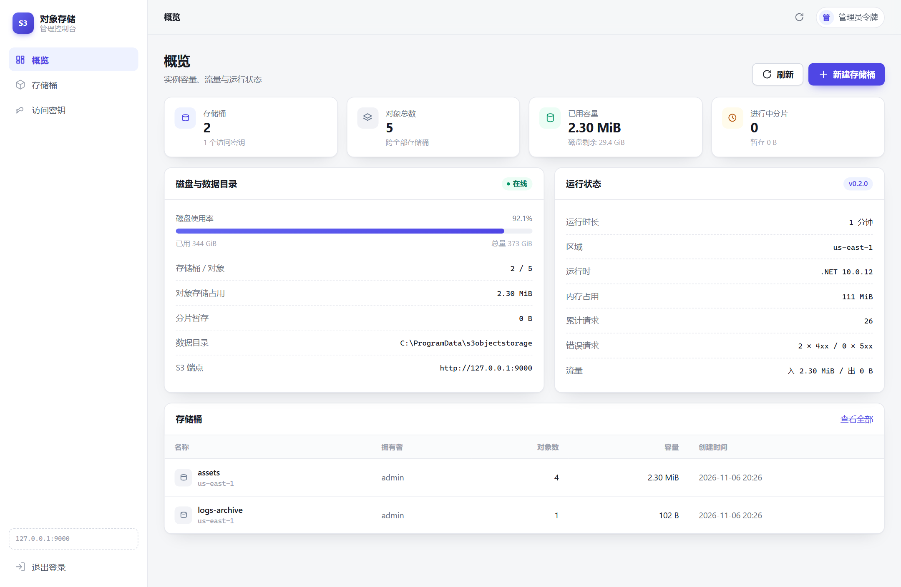
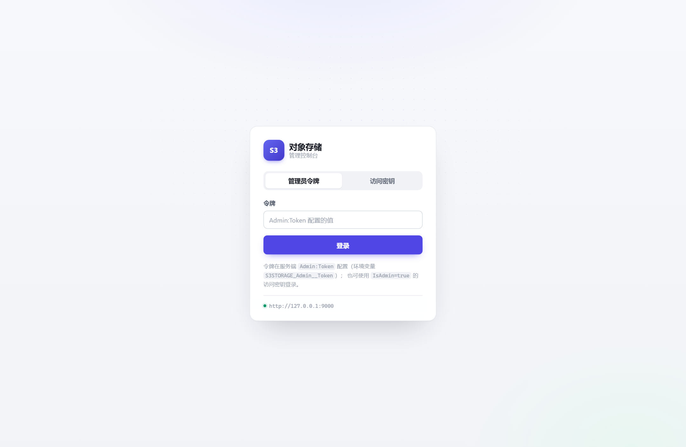
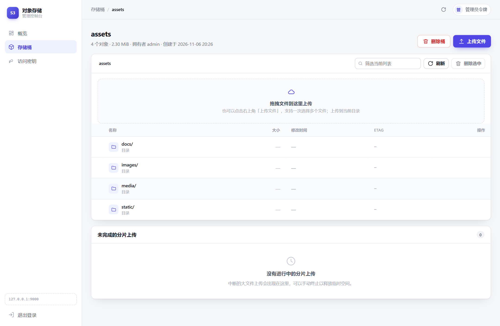

# S3ObjectStorage

**用 .NET 10 从零实现的 S3 兼容对象存储服务端**，内置网页管理控制台，可单容器部署。

[](https://github.com/OPEN96/ObjectStorage/actions/workflows/ci.yml)
[](LICENSE)
[](https://dotnet.microsoft.com/)
[](docs/api-support.md)

它实现了 AWS S3 REST API 的核心子集与 SigV4 鉴权（含预签名 URL、`aws-chunked` 流式负载、
MinIO 的 `STREAMING-UNSIGNED-PAYLOAD-TRAILER` 变体），可以直接对接 `aws cli`、`mc`、
boto3、minio-py、AWS SDK for .NET / Java / Node.js / Go 等客户端。

> 适合：单机对象存储、内网文件服务、S3 协议学习与二次开发、CI 中的 S3 替身。
> 不适合：需要多副本/多节点、版本控制、对象锁、精细 IAM 策略的生产场景（见[已知限制](#已知限制)）。



## 特性

- **S3 数据面**：桶与对象 CRUD、ListObjects V1/V2（prefix/delimiter/分页/`encoding-type=url`）、
  Range 下载、条件请求、批量删除、CopyObject、自定义元数据。
- **分片上传**：Initiate / UploadPart / Complete / Abort / ListParts / ListMultipartUploads。
- **SigV4**：Authorization 头与预签名 URL；三种 `aws-chunked` 变体（带签名链 / 带 trailer / 无签名 + trailer）。
- **MinIO 兼容**：`mc`、minio-py、minio-dotnet 实测通过；健康检查端点、`fetch-owner`、
  `encoding-type=url`、传输层头剥离等细节均已处理。
- **网页管理端** `/admin`：概览、存储桶、对象浏览器（拖拽上传/批量删除）、分片任务、访问密钥；
  原生 HTML/CSS/JS，无前端构建步骤。支持原地轮换 Secret，密钥禁用/删除/轮换后会话立即失效。
- **可靠写入**：临时文件 → 原子 rename；边写边算 MD5/SHA256；中断不留半截对象；
  后台回收并发覆写产生的孤儿对象体。
- **可运维**：结构化日志与 request-id、`live`/`ready` 健康检查、Docker 健康检查、
  非 root 容器、配置启动校验、元数据库 schema 版本守卫（拒绝降级启动）。
- **质量门禁**：85 项 xUnit 测试（含真实 Kestrel + AWS/MinIO SDK 集成测试）、
  可空引用、分析器、警告即错误、CI 格式检查。

## 快速开始

### 环境要求

- [.NET SDK 10.0.100+](https://dotnet.microsoft.com/download)（`global.json` 已固定，允许 feature 内前滚）
- 可选：Docker 24+、Python 3.10+、MinIO `mc`

### 本地运行

```bash
git clone git@github.com:OPEN96/ObjectStorage.git && cd ObjectStorage
dotnet run --project src/S3ObjectStorage.Api
```

`dotnet run` 会使用 `Properties/launchSettings.json` 中的 `Development` 环境，
自动加载 `appsettings.Development.json`：

| 项 | 开发默认值 |
| --- | --- |
| S3 Endpoint | `http://127.0.0.1:9000` |
| AccessKey / Secret | `AKIAEXAMPLELOCAL001` / `local-development-secret-please-change-me` |
| 管理端 | <http://127.0.0.1:9000/admin/>，令牌 `dev-admin-token-change-me` |

> 这些值**只存在于 Development 配置**。以 Production 运行时，缺少管理员令牌或初始密钥会直接拒绝启动。

验证：

```bash
aws --endpoint-url http://127.0.0.1:9000 s3 mb s3://demo
aws --endpoint-url http://127.0.0.1:9000 s3 cp README.md s3://demo/README.md
aws --endpoint-url http://127.0.0.1:9000 s3 ls s3://demo/
```

```bash
mc alias set local http://127.0.0.1:9000 AKIAEXAMPLELOCAL001 \
  local-development-secret-please-change-me --api S3v4 --path on
mc ls local
```

更多客户端示例见 [docs/client-guide.md](docs/client-guide.md)。

### Docker

```bash
cp .env.example .env
# 必须修改：ADMIN_TOKEN、S3_ACCESS_KEY、S3_SECRET_KEY
docker compose up -d --build

# S3:    http://127.0.0.1:9000
# Admin: http://127.0.0.1:9000/admin/
```

生产部署（systemd、Nginx/Caddy TLS、备份恢复、升级回滚）见 [docs/deployment.md](docs/deployment.md)。

## 配置

所有配置都可用环境变量覆盖，前缀 `S3STORAGE_`，层级用 `__`：

```bash
export S3STORAGE_Admin__Token="$(openssl rand -base64 48)"
export S3STORAGE_Storage__RootPath=/var/lib/s3objectstorage
export S3STORAGE_Storage__BootstrapAccessKeys__0__AccessKeyId=AKIA...
export S3STORAGE_Storage__BootstrapAccessKeys__0__SecretAccessKey="$(openssl rand -base64 36)"
export S3STORAGE_Storage__BootstrapAccessKeys__0__IsAdmin=true
```

常用配置：

| 配置 | 默认值 | 说明 |
| --- | --- | --- |
| `S3:Region` | `us-east-1` | 对外宣称的区域 |
| `S3:RequireAuthentication` | `true` | 关闭后允许匿名访问（仅调试） |
| `S3:EnforceRegion` | `false` | 是否强制客户端 region 一致 |
| `Storage:RootPath` | `data/objectstorage` | 元数据库 + 对象体根目录 |
| `Storage:VerifyPayloadHash` | `true` | 校验 `x-amz-content-sha256` |
| `Storage:MaxSinglePutBytes` | `0` | 单 PUT 上限，0 表示不限 |
| `Admin:Enabled` | `true` | 是否启用 `/admin` |
| `Admin:Token` | 空 | 生产必填，≥24 位；Development 可留空自动生成 |
| `Admin:SessionHours` | `12` | 管理端会话有效期 |

完整列表与生产检查清单：[docs/configuration.md](docs/configuration.md)。

## 网页管理端

浏览器打开 `/admin/`（直接访问根路径也会跳转）。支持两种登录方式：

1. **管理员令牌** —— `Admin:Token` / `S3STORAGE_Admin__Token`；
2. **管理员访问密钥** —— `IsAdmin=true` 的 AccessKey + Secret，适合多人各用各的凭证。

登录后签发 HMAC-SHA256 签名的 HttpOnly Cookie（`SameSite=Lax`），服务端不保存会话；
Cookie 与签发密钥绑定，密钥被禁用、删除或轮换后立即失效。

| 模块 | 能力 |
| --- | --- |
| 概览 | 桶数/对象数/容量、磁盘使用率、运行时长与内存、请求与流量、分片暂存 |
| 存储桶 | 列表、创建、删除（非空桶需二次确认强制清空） |
| 对象浏览器 | 目录导航、前缀筛选、拖拽/多选上传（带进度）、下载、单个与批量删除 |
| 分片上传 | 未完成任务、已传分片/字节、手动终止 |
| 访问密钥 | 创建（Secret 只显示一次）、启用/禁用、原地轮换 Secret、删除；保护最后一个管理员密钥 |

<p align="center">
  
  
</p>

## 兼容性

| 客户端 | 验证内容 | 结果 |
| --- | --- | --- |
| AWS SDK for .NET 4.x | 桶/对象/分片/预签名/条件请求/管理端 | 85 项集成测试通过 |
| MinIO .NET SDK 6.x | 桶/对象/分片/预签名/`encoding-type=url` | 通过 |
| minio-py 7.x | 20 项（特殊字符 key、分片、复制、预签名） | 20/20 |
| MinIO `mc` | 12 项（alias/建桶/上传/下载/元数据/预签名/删除） | 12/12（本机复跑通过） |
| 独立 SigV4 脚本 | 18 项协议行为 | 18/18 |

API 支持矩阵、错误码与未实现项：[docs/api-support.md](docs/api-support.md)。

## 构建与发布

一键完成依赖还原、构建、测试与产物输出：

```bash
bash scripts/build.sh                 # restore + build + test + publish
bash scripts/build.sh --no-test       # 跳过测试，快速出包
bash scripts/build.sh --build-only    # 只构建
bash scripts/build.sh --clean         # 先清理 bin/obj/artifacts

# 交叉编译自包含单文件（目标机器无需 .NET 运行时）
RID=linux-x64 bash scripts/build.sh
```

产物输出到 `artifacts/publish/`；支持的环境变量（`CONFIG`、`VERSION`、`RID`）见脚本头部注释。

等价的手工命令：

```bash
dotnet restore
dotnet build -c Release
dotnet test -c Release
dotnet publish src/S3ObjectStorage.Api -c Release -o artifacts/publish
dotnet publish src/S3ObjectStorage.Api -c Release -r linux-x64 --self-contained \
  -p:PublishSingleFile=true -o artifacts/publish/linux-x64
```

容器镜像构建与生产加固参数见 [docs/deployment.md](docs/deployment.md)。

### 自动化发布（GitHub Actions）

`.github/workflows/release.yml` 在以下两种情况下运行完整发布流水线：

- **推送标签**：`git tag v0.2.1 && git push origin v0.2.1`
- **手动触发**：Actions 页面选择 Release 工作流（可指定版本号；镜像默认只构建不推送）

流水线内容：

| 阶段 | 说明 |
| --- | --- |
| 测试门禁 | 格式检查 + 构建 + 全量单元测试，通过后才出包 |
| 原生可执行文件 | `linux-x64`、`linux-arm64`、`win-x64` 自包含单文件（目标机器无需 .NET 运行时），tar.gz / zip 分平台打包 |
| Docker 镜像 | `linux/amd64` + `linux/arm64` 多架构构建，推送至 GHCR（`ghcr.io/<owner>/<repo>:<版本>`，标签推送额外更新 `latest`） |
| GitHub Release | 汇总三个平台安装包并生成 `SHA256SUMS.txt` |

标签推送不会触发 ci.yml / codeql.yml，发布流水线因此自带完整测试门禁。

## 项目结构

| 路径 | 职责 |
| --- | --- |
| `src/S3ObjectStorage.Domain` | 实体、仓储抽象、`S3ErrorCode` |
| `src/S3ObjectStorage.Infrastructure` | EF Core SQLite 元数据、本地文件系统 blob、孤儿回收 |
| `src/S3ObjectStorage.S3Protocol` | SigV4、aws-chunked 解码、S3 XML、路由、URL 编码 |
| `src/S3ObjectStorage.Api` | Minimal API 主机、中间件、S3 操作、管理端 |
| `src/S3ObjectStorage.Api/wwwroot/admin` | 管理端前端（原生 HTML/CSS/JS） |
| `tests/S3ObjectStorage.Tests` | 单元测试 + 真实 Kestrel 集成测试 |
| `scripts/build.sh` | 一键构建脚本（还原、构建、测试、发布产物） |
| `scripts/` | 其余为独立客户端兼容性与基准/安全验证脚本（凭据经环境变量注入） |
| `docs/` | 配置、部署、客户端、架构、API 支持矩阵、验收测试报告 |

设计说明见 [docs/architecture.md](docs/architecture.md)。

## 测试

```bash
dotnet test                                  # 85 项：单元 + AWS/MinIO SDK 集成

# 以下脚本需要先启动服务端
python scripts/smoke.py                      # 独立实现 SigV4，18 项
python scripts/minio_compat.py               # minio-py，20 项
MC_BIN=$(command -v mc) bash scripts/mc_compat.sh   # mc CLI，12 项
```

`dotnet test` 会启动真实 Kestrel 并通过 HTTP 调用，因此同时覆盖 SigV4、XML 报文与 HTTP 语义。

## 安全

- 默认强制 SigV4；默认校验负载 SHA256 与 Content-MD5；
- 生产环境启动校验：示例密钥、过短令牌、缺少初始密钥都会拒绝启动；
- 管理端：CSP、`X-Frame-Options: DENY`、`nosniff`、跨站 Origin 校验、登录节流、请求体上限；
- 分片 `uploadId` 与桶/key 绑定，防止跨租户续传或终止；
- 不发送 `Server` 头，静态资源禁止缓存。

**必须**前置 TLS 反向代理；访问密钥以明文存放在 SQLite（SigV4 协议要求可还原的 Secret），
需配合目录权限与磁盘加密。完整威胁模型与报告方式见 [SECURITY.md](SECURITY.md)。

## 已知限制

- **单机**：SQLite + 本地磁盘，不支持多实例共享；无副本与纠删码。
- **无版本控制 / 对象锁 / 生命周期 / 桶策略 / ACL / CORS / 事件通知 / 服务端加密**；
  相关子资源返回 `501`。
- **无 EF Core migrations**：建库与版本由 `SchemaGuard` 管理（`PRAGMA user_version`），
  低版本库按序升级、高版本库拒绝启动；schema 变更会提供迁移说明。
- **无 IAM**：只有管理员 / 普通密钥 / 桶 owner 三种身份。
- **分片最小 5 MiB 限制未强制**（方便本地调试），生产客户端通常自行遵守。
- **覆写放大**：并发覆写同 key 会短暂留下旧对象体，由孤儿回收器在宽限期后清理
  （`Storage:OrphanSweep*` 配置项）。
- **管理端上传为单次 PUT**，超大文件请用 S3 客户端分片上传。
- **无操作审计日志**，仅有应用日志（含 request-id）。
- `mc admin`、`arn:minio:sqs` 等 MinIO 专有管理 API 未实现；常规数据面操作可用。

## 文档

| 文档 | 内容 |
| --- | --- |
| [docs/configuration.md](docs/configuration.md) | 全部配置项、环境变量、生产检查清单 |
| [docs/deployment.md](docs/deployment.md) | systemd、Docker、Nginx/Caddy、备份恢复、故障排查 |
| [docs/client-guide.md](docs/client-guide.md) | aws cli / mc / boto3 / minio-py / .NET / Java / Node.js |
| [docs/api-support.md](docs/api-support.md) | S3 API 支持矩阵与错误码 |
| [docs/architecture.md](docs/architecture.md) | 分层、请求链路、存储布局、设计取舍 |
| [docs/commercial-test-report.md](docs/commercial-test-report.md) | 0.2.0 商业级验收测试报告（性能、故障注入、安全、备份、长稳） |
| [CONTRIBUTING.md](CONTRIBUTING.md) | 开发环境、代码规范、提交与 PR 流程 |
| [CHANGELOG.md](CHANGELOG.md) | 版本变更记录 |
| [SECURITY.md](SECURITY.md) | 安全模型、已知风险、漏洞报告 |

## 贡献

欢迎 Issue 与 PR。提交前请阅读 [CONTRIBUTING.md](CONTRIBUTING.md) 并确保：

```bash
dotnet format --verify-no-changes
dotnet build -warnaserror
dotnet test
```

## 许可证

[MIT](LICENSE)。第三方组件许可见 [THIRD-PARTY-NOTICES.md](THIRD-PARTY-NOTICES.md)。
